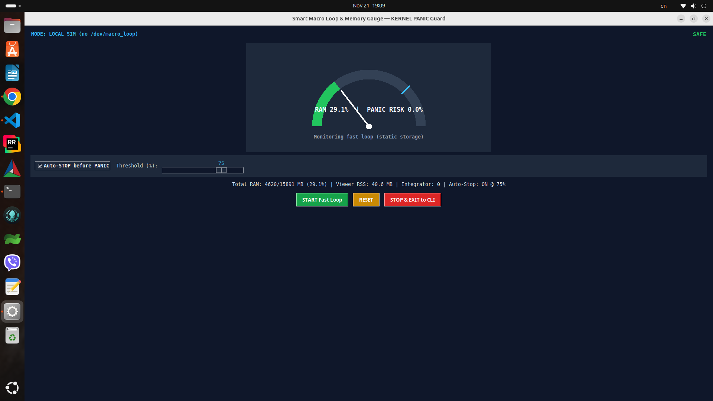
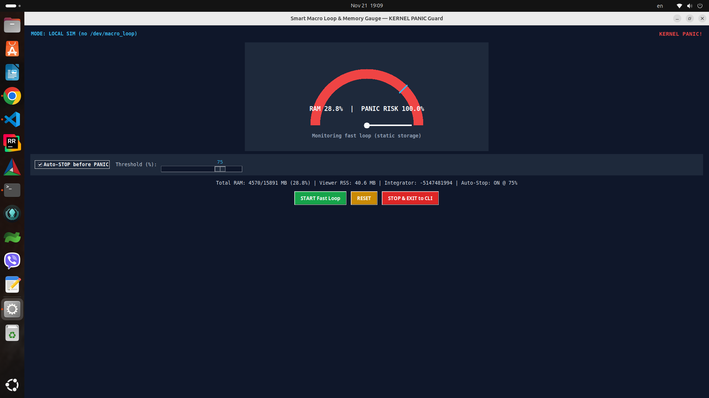

# Periodic Kernel Memory Leak & Fast-Loop Gauge Monitor

:


after_test:



Tools and kernel modules in `/home/natska/abb-kernel-memory-viewver` for monitoring memory usage, detecting periodic memory/runaway trends early, controlling fast loops from user space, and checking memory usage on the CLI before a `KERNEL PANIC!` or OOM condition occurs.

## Repository Layout

* `kernel/` — Out-of-tree Linux kernel modules (`gauge_macro_mod.c`, `abb_leak_mod.c`, `Kbuild`, `Makefile`).
* `poller/` — Fast C poller (`abb_poller.c`).
* `viewer/abb_ml_viewer.py` — ML / spectral periodicity detector and live viewer.
* `viewer/smart_gauge_viewer.py` — Semicircular gauge GUI with pre-panic Auto-STOP threshold and clean CLI exit summary.
* `gauge/smart_gauge_app.py` — RAM-focused gauge GUI connected to `/dev/gauge_macro` with `--check-only` CLI mode.

## Prerequisites

Install Tkinter (`python3-tk`) and `numpy` if needed:

```bash
sudo apt-get update && sudo apt-get install -y python3-tk python3-numpy
Build & Load Kernel Modules
Bash
cd /home/natska/abb-kernel-memory-viewver
make -C kernel clean && make -C kernel
sudo insmod kernel/gauge_macro_mod.ko
ls -l /dev/gauge_macro
To unload when finished:

Bash
sudo rmmod gauge_macro_mod
How to Use Each Python App (*.py)
1. viewer/smart_gauge_viewer.py (Gauge + Pre-Panic Auto-STOP + CLI Exit Summary)
Launch the GUI:

Bash
cd /home/natska/abb-kernel-memory-viewver
python3 viewer/smart_gauge_viewer.py
Toggle Auto-STOP before PANIC and adjust the Threshold (%) slider (10%–95%) as desired.

Click START Fast Loop to run, RESET to clear state, or STOP & EXIT to CLI to stop and return to the terminal with a final memory printout.

You can also run a quick memory check from the CLI:

Bash
python3 viewer/smart_gauge_viewer.py --check-only
2. gauge/smart_gauge_app.py (RAM Gauge for /dev/gauge_macro & --check-only)
Launch the RAM gauge GUI:

Bash
cd /home/natska/abb-kernel-memory-viewver
python3 gauge/smart_gauge_app.py
Use START Fast Loop, RESET, and STOP & EXIT to CLI to control the loop, monitor total system RAM and viewer RSS, and exit back to the shell.

Check current memory usage directly from the CLI without opening the GUI:

Bash
python3 gauge/smart_gauge_app.py --check-only
3. viewer/abb_ml_viewer.py (Periodicity / Leak Self-Test & Viewer)
Run the built-in synthetic periodicity self-test:

Bash
cd /home/natska/abb-kernel-memory-viewver
python3 -u viewer/abb_ml_viewer.py --self-test
Run the viewer directly:

Bash
cd /home/natska/abb-kernel-memory-viewver
python3 -u viewer/abb_ml_viewer.py
CLI Memory Verification After Stopping
After clicking STOP & EXIT to CLI in either GUI, verify system RAM on the command line:

Bash
free -h && cat /proc/meminfo | head -n 5
